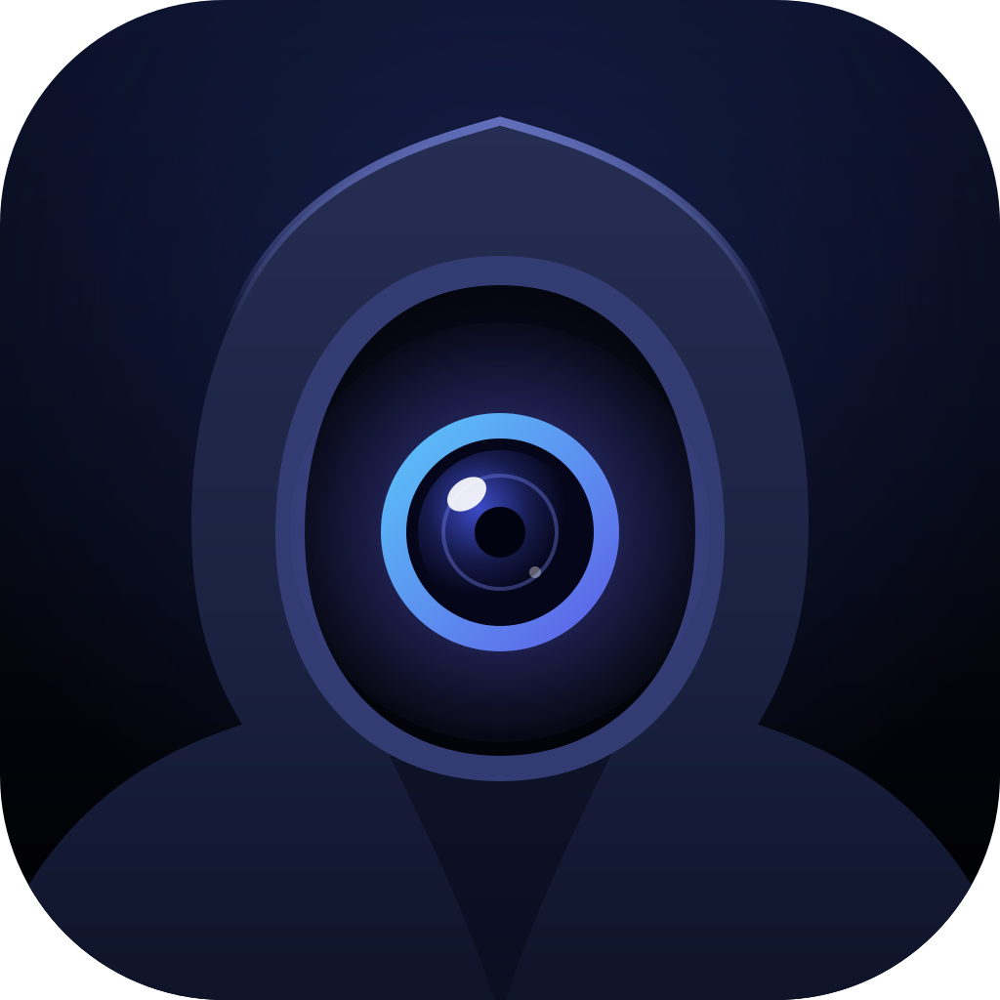

<p align="center"></p>

# Cipheroom

**Self-hosted, open-source video calls that your own server can't watch.**

Cipheroom is a Zoom / Telegram-style video calling app you run on your own machine. It's built for people who
want private calls without trusting a vendor, and it runs on a home computer with **no public IP and zero running cost**.

> [!WARNING]
> **Status: early development.** Every call is end-to-end encrypted: audio and video are encrypted in the browser,
> so neither your server nor the media server (Cloudflare's or your own LiveKit) can see or hear them. The encryption is our own design on
> standard WebCrypto primitives and **hasn't been independently audited** yet. Compare the in-call safety code
> out loud when it matters, and remember that metadata (who, when, IP addresses) stays visible to the servers.
> See the [roadmap](#roadmap).

## Why

Most video calls run through someone else's servers, and you have to take the vendor's word for what those servers
can see. Self-hosting usually swaps that for a different problem: your own server becomes the thing that can watch, and
running one needs a public IP, open ports and a monthly bill.

Cipheroom was built to remove both: calls that are end-to-end encrypted against **every** server in the path (your
own included), on a computer at home with **no public IP and no running cost**, with open source code that anyone
can read and run. Every design decision is checked against that: no feature may need plaintext media or keys on a
server, and a browser that can't encrypt can't join.

## Features

- 🎥 Group video and audio calls through [Cloudflare Realtime SFU](https://developers.cloudflare.com/realtime/sfu/),
  or a self-hosted [LiveKit](https://livekit.io) server on a machine with a public IP (`MEDIA_MODE=livekit`) —
  simulcast; Full HD by default, 4K or 720p selectable; each tile receives the size it needs
- 🖥️ Screen sharing, camera switching (front/rear on phones), active-speaker highlight, automatic reconnect
- 📶 Connection diagnostics: see whether your own link is the problem — route (direct or via a relay), round trip,
  loss, what you send and what limits it, encryption health; copy a numbers-only report to share. Computed in your
  browser, nothing is sent
- 🪟 Video layouts: Grid or Speaker view, pin anyone (or yourself, or a screen) to the stage, a floating self-view
  you can drag to any corner or minimize; small tiles receive smaller video, saving traffic
- 🏠 Runs at home behind NAT or CGNAT: nothing at home needs to be reachable — ingress via Cloudflare Tunnel, media
  straight between browsers and Cloudflare's edge
- 💸 Free to run: uses only free tiers, and a usage guard keeps Cloudflare's traffic inside the free tier — video is
  capped at 80% of the month's allowance, calls go audio-only at 95% and pause at 99% until the month resets
  (thresholds in `deploy/.env`; Grafana shows the numbers)
- 📈 Optional self-hosted observability: traces, logs, metrics, call quality and Grafana dashboards — pseudonymous,
  kept 7 days, behind Grafana's login ([`docs/observability.md`](docs/observability.md))
- 🔐 End-to-end encrypted media: per-call keys, rotated whenever someone joins or leaves, and a safety code to
  compare out loud. Browsers that can't encrypt can't join — calls never fall back to unencrypted
- 💬 End-to-end encrypted chat with emoji reactions — signed by each sender, kept in memory only, gone when you
  leave; links stay plain links (no previews that would leak them)
- 📎 End-to-end encrypted files and images in chat, up to 100 MB: sent straight from your browser over Cloudflare's
  SFU (never stored, not even on your server), each with its own key; photos lose their location and camera details
  before they leave; small images appear inline, everything else downloads on click
- 🚪 Lobby and host controls: a meeting belongs to a host key kept in the creator's browser (with a
  passphrase-protected backup). Guests knock and wait; the host or a co-host lets them in, removes people, asks them
  to mute, or ends the call. Every decision is signed and checked by each browser, so even a malicious server can't
  slip anyone in — and display names never reach the server unencrypted

## How it works

By default the website and all signaling go through a Cloudflare Tunnel to one hostname, so the server needs no
inbound web ports. Media goes to an SFU (a server that forwards each person's encrypted streams to the others), chosen
per deployment with `MEDIA_MODE`; with `INGRESS_MODE=direct` the server also serves the website itself:

**Cloudflare mode** (default, at home, free): media goes to Cloudflare's edge, and nothing at home is reachable from
the internet.

```
Browser ──HTTPS/WSS──▶ Cloudflare Tunnel ──▶ nginx ──▶ .NET api (SignalR: rooms, lobby, key envelopes, negotiation)
   │                                                     │ HTTPS (app secret, server-side only)
   └── encrypted media (WebRTC; Cloudflare TURN fallback) ──▶ Cloudflare Realtime SFU ◀──┘
```

**LiveKit mode** (a server with a public IP, e.g. Hetzner; this is how the beta runs): media goes to a self-hosted
LiveKit SFU on the same server and never touches Cloudflare. LiveKit's own signaling is relayed by the api over
SignalR, so its signaling/API port is never public; only its media and TURN ports are open.

```
Browser ──HTTPS/WSS──▶ Cloudflare Tunnel ──▶ nginx ──▶ .NET api ──(internal)──▶ LiveKit signaling
   │                                                                               │
   └── encrypted media (UDP 7882 / TCP 7881; TURN on 3478/udp, TLS 443) ──▶ LiveKit SFU (same server)
```

**Direct mode** (`INGRESS_MODE=direct` on top of LiveKit mode; no Cloudflare, no domain): the server answers HTTPS
itself at `https://<its IP>` with a free Let's Encrypt certificate for the IP address (renewed every few days). Port
443 carries both the site and TURN over TLS: an `edge` proxy tells them apart by what the client offers (browsers'
HTTPS offers ALPN, WebRTC's TURN doesn't).

```
Browser ──HTTPS/WSS (443)──▶ edge ──▶ nginx ──▶ .NET api ──(internal)──▶ LiveKit signaling
   │                          └── TURN over TLS (443) ──┐                  │
   └── encrypted media (UDP 7882 / TCP 7881; TURN 3478/udp) ──▶ LiveKit SFU (same server, host network)
```

In every mode the api checks that people only receive tracks from their own room, and the media server only ever
sees encrypted frames.

| Component | Tech |
|---|---|
| Backend | .NET 10, ASP.NET Core, SignalR (Clean Architecture, Mediator, FluentValidation) |
| Frontend | Angular 22, plain WebRTC; our own frame encryption (WebCrypto AES-GCM in a worker) |
| Media server | Cloudflare Realtime SFU (free tier: 1 TB/month, shared with TURN), **or** self-hosted LiveKit with built-in TURN |
| Ingress | Cloudflare Tunnel (`cloudflared`) on one hostname, **or** `edge` (nginx) on the server's IP with a Let's Encrypt IP certificate |
| Runtime | Docker Compose: api, web (nginx), cloudflared; profiles for LiveKit, direct ingress (edge) and the observability stack |
| Observability (optional) | OpenTelemetry → collector, Prometheus, Loki, Tempo, Grafana; pseudonymous, 7 days |
| Infrastructure (optional) | GitHub Actions → GHCR images; Terraform (Hetzner server + firewall) and Ansible (hardening + stack) |

**Privacy model:** the API, Cloudflare's SFU and the TURN relay are all treated as untrusted. Every participant
encrypts media in the browser with keys exchanged as signed, encrypted envelopes. Servers only relay ciphertext.
Who may join is decided by signatures from the meeting's host key, which every browser checks itself, and display
names travel only end-to-end encrypted. Metadata (when, IP addresses, how many people, which random id is host)
remains visible to the servers and Cloudflare. With the optional observability stack, your own server also keeps pseudonymous call
metadata and call-quality numbers for 7 days (no names, IPs or plain room ids). Details:
[`docs/architecture.md`](docs/architecture.md).

Guides for running and using it (self-hosting, Hetzner, media modes, security model, troubleshooting) are in the
[wiki](https://github.com/Alex-Fix/cipheroom/wiki); its sources live in [`docs/wiki/`](docs/wiki/).

## Quick start (local development)

Requirements: .NET 10 SDK, Node.js (LTS) and Docker. Calls go through a local LiveKit server that `scripts/dev.sh`
starts in Docker with throwaway keys, so no accounts are needed.

```bash
scripts/doctor.sh      # check your toolchain
scripts/dev.sh         # API on :5080 + Angular on :4200 + LiveKit in Docker
scripts/dev.sh --cloudflare   # or: Cloudflare Realtime SFU (scripts/secrets.sh, fill in CF_SFU_APP_ID / CF_SFU_APP_SECRET)
```

Open http://localhost:4200, create a **New Meeting** (you're its host), and open the invite link in a second
browser window: it knocks, and you let it in from the People panel.

## Self-hosting

You need a domain on Cloudflare (the free plan is fine) and a machine running Docker. No port forwarding.

1. **Create `deploy/.env`**
   ```bash
   scripts/secrets.sh     # creates deploy/.env and lists what still needs filling in
   ```
2. **Cloudflare Realtime SFU** (required): Dashboard → Realtime → SFU → Create application. Put the app ID and app
   secret into `CF_SFU_APP_ID` and `CF_SFU_APP_SECRET`.
3. **Cloudflare TURN** (fallback for strict networks): Dashboard → Realtime → TURN Server → Create. Put the key ID and
   API token into `CF_TURN_KEY_ID` and `CF_TURN_API_TOKEN`.
4. **Cloudflare Tunnel**: Zero Trust → Networks → Tunnels → Create (Cloudflared, Docker).
   - Put the token into `TUNNEL_TOKEN`.
   - Add one public hostname, e.g. `call.example.com` → **HTTP** `web:8080`.
   - Use a *first-level* subdomain: the free Universal SSL certificate doesn't cover `a.b.example.com`.
5. **Hostname**: set `PUBLIC_HOST=call.example.com` in `deploy/.env`.
6. **Start**
   ```bash
   scripts/up.sh --tunnel
   scripts/security-check.sh https://call.example.com
   ```

No machine at home to leave running? The same stack runs on a rented Hetzner server (billed by Hetzner), created with
Terraform and deployed with Ansible from prebuilt images, in Cloudflare mode or with its own LiveKit media server
(`MEDIA_MODE=livekit`): [`docs/deployment-hetzner.md`](docs/deployment-hetzner.md).

To check it from real networks, join from a phone on mobile data (Wi-Fi off) and a laptop in the same meeting. To test
the TURN fallback, set `TURN_FORCE_RELAY=true` and run `scripts/up.sh --tunnel` again. Keep an eye on usage: 4K video
is ~3.6 GB per viewer-hour against the 1 TB/month free tier. The usage guard enforces it (best with
`CF_ACCOUNT_ID` / `CF_ANALYTICS_API_TOKEN` set); keep a Cloudflare billing notification as a second safety net.

### Operations

| Command | What it does |
|---|---|
| `scripts/up.sh [--tunnel \| --direct] [--observability]` | Build and start the stack (`--observability`: Grafana at `/grafana/`, see [`docs/observability.md`](docs/observability.md); `--direct`: no Cloudflare, see below) |
| `scripts/ip-cert.sh` | Direct mode without Ansible: get or renew the Let's Encrypt certificate for this machine's IP (cron, twice a day) |
| `scripts/down.sh` | Stop everything |
| `scripts/logs.sh [service]` | Follow logs (`api`, `web`, `cloudflared`, `otel-collector`, `grafana`, …) |
| `scripts/test.sh [--server\|--web]` | Run tests |
| `scripts/lint.sh [--fix]` | Formatting and lint |
| `scripts/security-check.sh [url]` | Secret scan, dependency audit, security headers |
| `scripts/secrets.sh` | Create `deploy/.env` and list required values that are still empty |
| `scripts/provision.sh [--server <name>] [--destroy]` | Create or update a Hetzner server (Terraform; one per name) — [`docs/deployment-hetzner.md`](docs/deployment-hetzner.md) |
| `scripts/deploy.sh [--server <name>] [--tag <tag>] [--no-observability]` | Deploy or roll back that server from GHCR images (Ansible; Grafana on by default) |

## Roadmap

- [x] Group calls through Cloudflare Realtime SFU — nothing at home reachable from the internet (works behind CGNAT)
- [x] Quality selection (up to 4K), simulcast, automatic reconnect
- [x] Single-hostname deployment via Cloudflare Tunnel
- [x] **End-to-end encryption**: per-call identities, sender keys, rotation on join/leave, safety codes
- [x] Remember contacts across calls (TOFU): known / verified marks, a warning for a verified name with another key —
  device keys travel only inside encrypted envelopes, so the server still can't link calls
- [x] Lobby and host admission: host keys, signed tickets, co-hosts, remove, auto-admit, end for everyone
- [x] End-to-end encrypted chat: text, emoji reactions, links (no previews); memory only
- [x] Observability: traces, logs, metrics, call-quality reports, Grafana dashboards (self-hosted, optional)
- [x] Usage guard for the Cloudflare Realtime free tier (SFU + TURN): saving → audio-only → paused
- [x] Connection diagnostics: a Connection drawer with a verdict, route, network numbers, what you send, encryption
  health and a copyable report; a "Poor connection" hint in the header
- [x] "Source code" link in the UI (AGPL §13) — opens the exact commit that is running (`SOURCE_URL` for forks)
- [x] End-to-end encrypted files and images in chat (up to 100 MB, from the sender's browser over SFU data channels,
  photo metadata removed)

### Deployment modes

Three modes, chosen per deployment with `MEDIA_MODE` and `INGRESS_MODE`:

- [x] **Cloudflare** (default): Cloudflare Tunnel for HTTPS/WSS, Cloudflare Realtime SFU and TURN. No public IP,
  free tier only.
- [x] **Tunnel + self-hosted media** (`MEDIA_MODE=livekit`): Cloudflare Tunnel for HTTPS/WSS, a self-hosted
  [LiveKit](https://livekit.io) SFU with its built-in TURN on the same machine, reached on its public IP — media never
  touches Cloudflare. Same end-to-end encryption; LiveKit's signaling is relayed over SignalR
  ([`docs/deployment-hetzner.md`](docs/deployment-hetzner.md#livekit-mode-media-on-your-server)). No Cloudflare
  Realtime traffic limits.
- [x] **Fully self-hosted** (`INGRESS_MODE=direct`): LiveKit and its TURN as above, and the app served directly at
  `https://<server IP>` with a Let's Encrypt certificate for that IP — no domain and no Cloudflare at all. Port 443 is
  shared by the site and TURN over TLS
  ([`docs/deployment-hetzner.md`](docs/deployment-hetzner.md#direct-mode-no-cloudflare-no-domain)).
- [x] Infrastructure as code for Hetzner: GitHub Actions publishes the images to GHCR, Terraform creates a firewalled
  server, Ansible hardens it and runs the stack in either mode
  ([`docs/deployment-hetzner.md`](docs/deployment-hetzner.md)). The beta runs this way: Hetzner cpx42, LiveKit mode.
- [x] Security audits of the app and the live servers: 2026-10-11 (all findings fixed or mitigated) and 2026-10-14
  (direct mode: no Critical/High, one Medium follow-up) ([`docs/security/audits/`](docs/security/audits/README.md)).

The self-hosted modes need a public IP (and open UDP ports for media). On Hetzner they also cost money, unlike the
default mode at home, which stays free.

## Project layout

```
src/          .NET api (Domain, Application, Infrastructure, Api)
tests/        .NET tests, one project per layer; shared test vectors
web/          Angular app (crypto in src/app/core/crypto/)
deploy/       Docker Compose, nginx, cloudflared, LiveKit, observability config; terraform/hetzner, ansible
scripts/      dev and ops scripts (dev, up/down, test, lint, security-check, provision, deploy)
docs/         architecture, signaling protocol, Hetzner guide, design plans, security audits, wiki sources
.github/      image builds to GHCR, Dependabot
.claude/      Claude Code skills and settings used to develop this project
```

## Contributing

Issues and pull requests are welcome. Before opening a PR:

- `scripts/test.sh` and `scripts/lint.sh` pass
- Protocol changes update C#, TypeScript and [`docs/signaling-protocol.md`](docs/signaling-protocol.md) together
- Nothing sends keys, plaintext media or chat to any server. See [`CLAUDE.md`](CLAUDE.md) for the
  non-negotiable rules.

New features start as a short design in [`docs/plans/`](docs/plans/).

## Security

Please **don't** open public issues for vulnerabilities. Report them privately via GitHub's
"Report a vulnerability" (Security tab).

Audit reports — what was checked on the app and a live server, what was found and fixed — are in
[`docs/security/audits/`](docs/security/audits/README.md).

## License

Cipheroom is licensed under the [GNU Affero General Public License v3.0](LICENSE).
If you run a modified version as a network service, you must offer its source code to your users.

The logo and app icons are licensed separately under [CC BY-SA 4.0](LICENSE-ASSETS.md).

Third-party components keep their own licenses. Media runs on Cloudflare Realtime (a hosted service, used within its
free tier); everything that runs on your machine is open source.